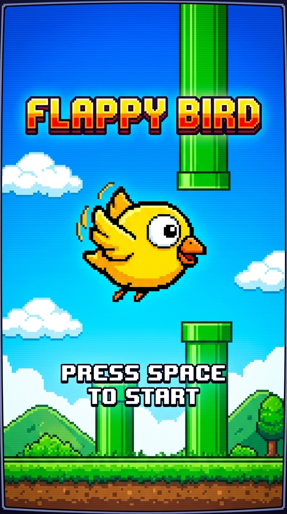
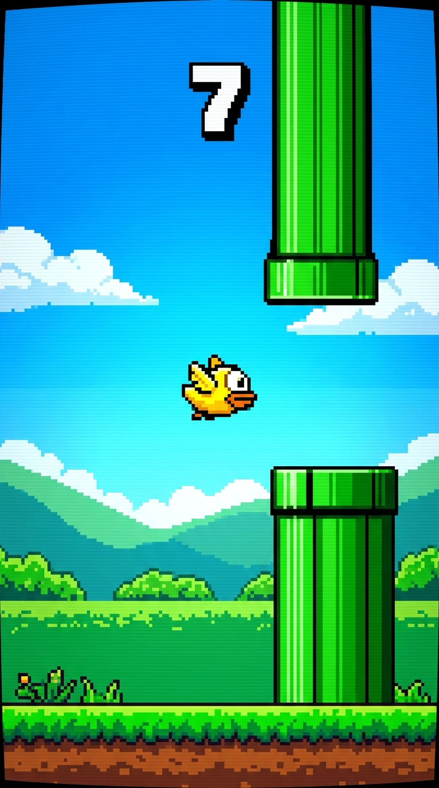
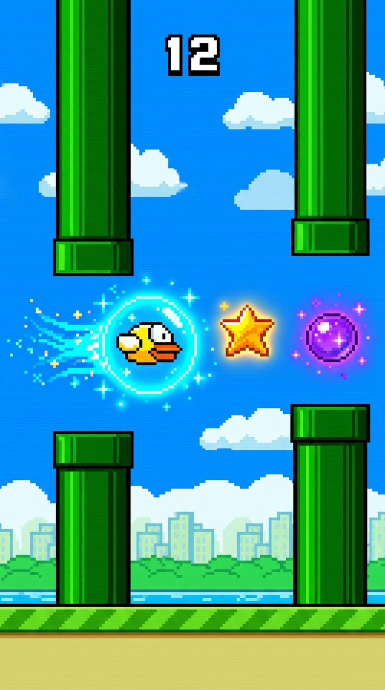
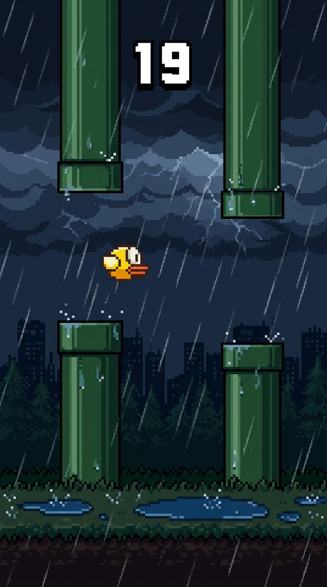
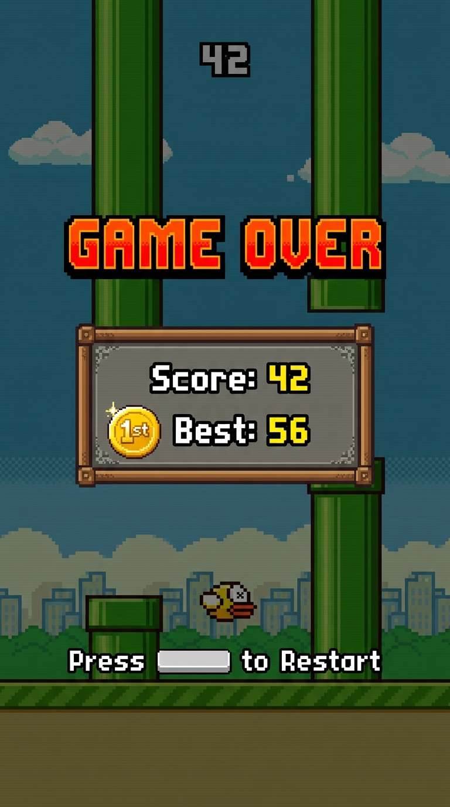
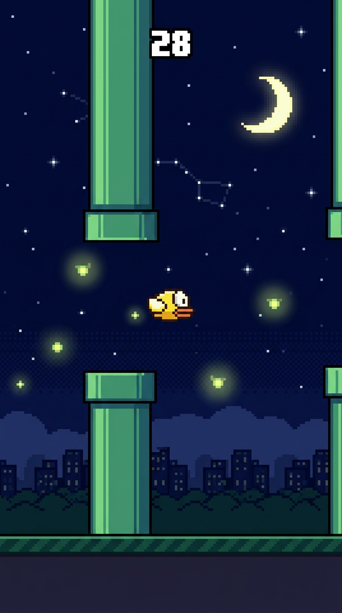

<div align="center">

# 🐦 Flappy Bird — Rust Edition

**A high-performance, asset-free, feature-rich reimagining of Flappy Bird built entirely in Rust.**

[](https://www.rust-lang.org/)
[](https://macroquad.rs/)
[](https://github.com/WARRIORXR/flappy-bird/releases/latest)
[](LICENSE)
[](https://github.com/WARRIORXR/flappy-bird)
[](https://github.com/WARRIORXR/flappy-bird)
[](https://flappy-bird-pro.thundering-stocking.workers.dev)
[](https://github.com/WARRIORXR/flappy-bird/pulls)

<p align="center">
  <b>100% Procedural Rendering</b> • <b>Real-Time Audio Synthesis</b> • <b>Dynamic Weather Engine</b><br>
  <b>Persistent Achievements</b> • <b>Power-Up Combat Mechanics</b> • <b>Zero Sprite Sheets or External Audio Assets</b>
</p>

</div>

---

## 📑 Table of Contents

- [Overview & Philosophy](#-overview--philosophy)
- [📸 Game Photos](#-game-photos)
- [📦 Download Executable & Live Play](#-download-executable)
- [Quick Start](#-quick-start)
- [Controls](#-controls)
- [Deep Gameplay Systems](#-deep-gameplay-systems)
  - [⚡ Power-Up Arsenal](#-power-up-arsenal)
  - [🌧️ Atmospheric Weather Engine](#️-atmospheric-weather-engine)
  - [🏆 Persistent Achievement System](#-persistent-achievement-system)
  - [📊 Difficulty Modes & Scoring Economy](#-difficulty-modes--scoring-economy)
  - [🎨 Procedural Bird Skins](#-procedural-bird-skins)
  - [🌅 Day / Sunset / Night Celestial Cycle](#-day--sunset--night-celestial-cycle)
  - [🔊 In-Memory Procedural Audio Synthesizer](#-in-memory-procedural-audio-synthesizer)
  - [💥 Visual FX & Screen Polish](#-visual-fx--screen-polish)
- [Project Architecture](#-project-architecture)
- [Save Data & Persistent SQLite Database](#-save-data--persistent-sqlite-database)
- [🌐 Web & 📱 Android Playable Guide](#-web--android-playable-guide)
  - [🚀 Launch Web & Database Server](#-launch-the-web--database-server)
  - [📱 Android Play & PWA Installation](#-android-play--pwa-installation)
  - [📦 Native Android Studio APK Project](#-native-android-studio-apk-project)
  - [☁️ Cloudflare Edge Deployment](#️-cloudflare-edge-deployment)
- [Cross-Platform Compilation Guide](#-cross-platform-compilation-guide)
  - [Windows](#windows)
  - [macOS](#macos)
  - [Linux (Ubuntu / Debian)](#linux-ubuntu--debian)
  - [WebAssembly (WASM Browser Build)](#webassembly-wasm-browser-build)
- [Contributing](#-contributing)
- [License](#-license)

---

## 💡 Overview & Philosophy

**Flappy Bird — Rust Edition** is designed around a singular technical philosophy: **absolute self-containment**.

- **Zero Sprite Sheets**: Every element — the bird, flapping wings, beak, blinking eyes, oscillating pipes, layered clouds, parallax ground, chevrons, pebbles, and celestial bodies — is calculated and drawn using geometric primitives and trigonometric functions at runtime.
- **Zero Audio Files**: No `.mp3`, `.wav`, or `.ogg` files are bundled. The game features an integrated software synthesizer that constructs valid RIFF/WAVE byte buffers in memory using sine waves, frequency chirps, arpeggio scales, and noise generators.
- **Sub-Millisecond Execution**: Powered by [macroquad](https://macroquad.rs/) on modern OpenGL/WebGL, delivering locked, responsive 60+ FPS performance with minimal CPU and memory overhead.
- **Virtual Resolution Scaling**: Runs on a crisp, fixed 400×700 virtual canvas that scales and letterboxes cleanly to any window dimensions or display aspect ratio.

### ⚡ Performance & Engine Optimizations
- **Zero-GC Object Pooling**: Particles and text popups are managed via fixed-size pre-allocated pools (`MAX_PARTICLES = 128`, `MAX_POPUPS = 16`). Eliminates runtime heap allocations and avoids browser garbage collector pauses during gameplay.
- **Batched Canvas Draw Calls**: Ground chevrons, parallax clouds, and weather particle simulations batch path segments into single stroke/fill operations, slashing canvas draw calls by up to 40x per frame.
- **Precompiled Celestial Gradients**: Linear sky gradients for Day, Sunset, Night, and Dawn are precompiled and cached at initialization, eliminating per-frame gradient reconstruction.
- **Opaque Context & GPU Containment**: HTML5 canvas uses `{ alpha: false, desynchronized: true }`, `transform: translateZ(0)`, and CSS `contain: layout paint` to maximize browser compositor throughput and eliminate layout reflows.
- **Rust Fat LTO Release Profile**: Native and WASM builds compile with `lto = "fat"`, `codegen-units = 1`, `opt-level = 3`, `strip = true`, and `overflow-checks = false` for peak instruction pipelining and auto-vectorization.
- **Edge CDN Immutable Caching**: Static assets and WebAssembly binaries (`.wasm`) are served with `Cache-Control: public, max-age=604800, immutable` headers for instant edge response.

---

## 📸 Game Photos

<div align="center">

| Start Screen | Active Gameplay |
|:---:|:---:|
|  |  |
| *Start Screen with Skin, Difficulty & Weather Selector* | *Active Run navigating through Pipe Gaps* |

| Power-Ups Active | Atmospheric Weather |
|:---:|:---:|
|  |  |
| *Energy Shield Bubble & Floating Power-Up Orbs* | *Dynamic Rain Particles with Ground Splashes* |

| Game Over Scoreboard | Night Mode Celestial Cycle |
|:---:|:---:|
|  |  |
| *Scoreboard with Medals, Best Scores & Achievements* | *Night Sky Cycle with Twinkling Stars & Moon* |

</div>

---

## 📦 Download Executables & Multi-Platform Releases

> **Ready to Play?** No Rust compiler or toolchain needed! Standalone native executables are ready to play across all desktop platforms:

| Platform | Target Architecture | Download Link | Build Type |
|:---|:---|:---:|:---:|
| 🪟 **Windows** | x86_64 (`.exe`) | [📥 **flappy-bird-rust.exe (v1.6.0)**](flappy-bird-rust.exe) | Standalone Native Binary (~834 KB) |
| 🐧 **Linux** | x86_64 (`glibc / alsa`) | [📥 **flappy-bird-linux**](https://github.com/WARRIORXR/flappy-bird/releases/latest) | Standalone Native Binary |
| 🍎 **macOS** | Apple Silicon (`M1/M2/M3/M4`) | [📥 **flappy-bird-macos-arm64**](https://github.com/WARRIORXR/flappy-bird/releases/latest) | Standalone Native Binary |
| 🍏 **macOS** | Intel (`x86_64`) | [📥 **flappy-bird-macos-x64**](https://github.com/WARRIORXR/flappy-bird/releases/latest) | Standalone Native Binary |

*On Windows, double-click `flappy-bird-rust.exe` to play instantly!*  
*On Linux / macOS, run `chmod +x flappy-bird-* && ./flappy-bird-*` to launch!*

---

## 🚀 Quick Start

### 🌐 Play Live in Browser (Cloudflare Edge Global CDN)
> **Zero Installation Required!** Play directly on desktop, tablet, or smartphone:  
> 🔗 [**https://flappy-bird-pro.thundering-stocking.workers.dev**](https://flappy-bird-pro.thundering-stocking.workers.dev)  
> 🔗 [**https://flappy-bird-pro.chill-fox.workers.dev**](https://flappy-bird-pro.chill-fox.workers.dev)

### 🪟 Play on Windows (Desktop Executable)
Just download [`flappy-bird-rust.exe`](flappy-bird-rust.exe) and double-click to launch!

### 🐧 Build & Run on Linux
Run our one-click automated build script:
```bash
chmod +x build_linux.sh
./build_linux.sh
```

### 🍎 Build & Run on macOS
Run our one-click automated build script:
```bash
chmod +x build_macos.sh
./build_macos.sh
```

### Build from Source (Any Platform)
Make sure you have the Rust toolchain installed (1.70 or higher). If needed, install via [rustup.rs](https://rustup.rs):
```bash
curl --proto '=https' --tlsv1.2 -sSf https://sh.rustup.rs | sh
```

```bash
# Clone the repository
git clone https://github.com/WARRIORXR/flappy-bird.git
cd flappy-bird/flappy-bird-rust

# Run in optimized release mode
cargo run --release
```

---

## 🎮 Controls & Two-Player Duel Mode

### ⚔️ Local Two-Player Battle / Duel & Match Series
Challenge a friend on the same keyboard, touchscreen, or mobile device!
- **Mode Toggle**: Press <kbd>2</kbd> or <kbd>Tab</kbd> on desktop, or tap `[ ⚔️ 2P Duel ]` in the clean top header.
- **Independent Physics & Audio**: Bird 1 (Gold, 420Hz chirp) and Bird 2 (Blue, 320Hz tone) flap and fall with their own momentum and distinct audio cues.
- **Match Series Standing**: Tracks running match wins across rematches (`⚔️ SERIES: P1 [2] - [1] P2`) on the live HUD and Game Over summary.
- **Victory System**: When one bird crashes, the survivor keeps flying to score more points. The winner is crowned with trophy flair and recorded in the SQLite database!

| Player | Keyboard (Desktop / Web) | Mobile / Touchscreen (Web / Android) | Flap Tone |
|:---|:---|:---|:---:|
| 🟡 **Player 1 (Gold Bird)** | <kbd>Space</kbd> or <kbd>W</kbd> | **Tap Left Half** of screen | 420 Hz Harmonic Chirp |
| 🔵 **Player 2 (Blue Bird)** | <kbd>↑ Up Arrow</kbd> or <kbd>K</kbd> | **Tap Right Half** of screen | 320 Hz Warm Tone |

### 🕹️ General & Hotkey Reference

| Key / Input | Context | Action |
|:---:|:---:|:---|
| <kbd>Space</kbd> / <kbd>W</kbd> / <kbd>Left Click</kbd> | Solo In-Game | **Flap wings** (upward velocity burst) |
| <kbd>2</kbd> / <kbd>Tab</kbd> | Start / Game Over | **Toggle Solo ⇄ 2P Duel Mode** |
| <kbd>Space</kbd> / <kbd>R</kbd> / <kbd>↑</kbd> | Game Over | **Instant Quick Rematch / Restart** |
| <kbd>F11</kbd> / <kbd>Alt</kbd>+<kbd>Enter</kbd> | Any screen | **Toggle Fullscreen Mode** (edge-to-edge monitor display) |
| <kbd>X</kbd> | Any screen | **Toggle Screen Fit** (`Full Window` ➔ `Fit 4:7 Letterbox`) |
| <kbd>Z</kbd> / <kbd>F10</kbd> | Windowed | **Cycle Window Size Presets** (`400×700` ➔ `480×840` ➔ `560×980` ➔ `640×1120`) |
| <kbd>P</kbd> | Playing | **Pause / Unpause game** |
| <kbd>N</kbd> | Start / Playing | **Cycle Sky / Celestial Cycle** (`Auto` ➔ `Day` ➔ `Sunset` ➔ `Night` ➔ `Dawn`) |
| <kbd>M</kbd> | Any screen | **Toggle audio mute / unmute** |
| <kbd>D</kbd> | Start Screen | **Cycle Difficulty** (`Easy` ➔ `Normal` ➔ `Hard`) |
| <kbd>C</kbd> | Start Screen | **Cycle Bird Skin** (`Classic` ➔ `Blue` ➔ `Red` ➔ `Green` ➔ `Purple`) |
| <kbd>W</kbd> | Start Screen | **Cycle Weather** (`Clear` ➔ `Rain` ➔ `Snow` ➔ `Sakura` ➔ `Firefly`) |
| <kbd>F</kbd> | Any screen | **Toggle real-time FPS overlay** |
| <kbd>R</kbd> | Game Over | **Instant quick restart** |

> 💡 **Window Resize**: You can also freely drag and resize the window edges to any custom width and height!

---

## 🌟 Deep Gameplay Systems

### ⚡ Power-Up Arsenal

Power-ups spawn periodically in the vertical gap between incoming pipes with bobbing physics and a glowing outer halo.

| Power-Up | Symbol | Duration | Color | Aura & Visual Effect | Mechanical Benefit |
|:---|:---:|:---:|:---:|:---|:---|
| **Energy Shield** | `S` | Single Hit | Cyan (`#40E0FF`) | Pulsing concentric forcefield bubble | Absorbs one fatal collision, triggers a shockwave, camera shake, and grants **1.2s mercy invulnerability**. |
| **Coin Magnet** | `M` | 8.0s | Orchid (`#DA70D6`) | Rotating 16-point electric field | Exerts inverse-distance magnetic pull on all onscreen coins, dragging them directly to the bird. |
| **Slow-Mo (Time Warp)** | `T` | 6.0s | Gold (`#FFD700`) | Cyan vignette border | Dilates world time by 40% (0.6x speed), dramatically slowing pipe and obstacle advance for precision maneuvers. |
| **Double Score (2X)** | `2` | 10.0s | OrangeRed (`#FF4500`) | Rotating hexagonal fire aura + warm vignette | **2× Multiplier** on all points earned from passing pipes and collecting coins. |

---

### 🌧️ Atmospheric Weather Engine

The weather system alters atmospheric visuals with drifting particle simulations:

- ☀️ **Clear Sky**: Crisp blue gradients with serene parallax drifting clouds.
- 🌧️ **Rain**: High-speed, slanted rainfall streaks with dynamic ground spatter.
- ❄️ **Snow**: Gentle, meandering snowflakes driven by sinusoidal lateral wind drift.
- 🌸 **Sakura**: Floating Japanese cherry blossom petals with variable rotational torque and wind sway.
- 🪲 **Firefly**: Nighttime bioluminescent orbs drifting in gentle organic paths with breathing dual-layer glow effects.

> 💡 **Dynamic Transitions**: While weather can be manually chosen via <kbd>W</kbd>, it also shifts dynamically as your score progresses: **Score 20 ➔ Rain**, **Score 40 ➔ Snow**, **Score 60 ➔ Sakura**, and **Score 80 ➔ Firefly**!

---

### 🏆 Persistent Achievement System

10 built-in achievements automatically tracked and saved to `achievements.txt`. Unlocking an achievement triggers an animated slide-in golden banner with a trophy icon.

| Icon | Achievement | Objective Requirement | Tracking Mode |
|:---:|:---|:---|:---:|
| 🪽 | **First Flight** | Score your first point | Per-game |
| 💰 | **Coin Collector** | Collect 10 coins in a single run | Per-game |
| 🛡️ | **Shield Master** | Absorb 3 fatal collisions with shields in one run | Per-game |
| 💪 | **Survivor** | Reach an individual score of 25 | Per-game |
| 🏎️ | **Speed Demon** | Score 50 or higher on **Hard** difficulty | Per-game |
| 🎯 | **Perfectionist** | Maintain a 20× flawless pipe combo | Per-game |
| 💯 | **Centurion** | Reach a grand score of 100 points | Per-game |
| 👑 | **Coin King** | Accumulate 50 coins across all lifetime sessions | Lifetime |
| 🎖️ | **Veteran** | Play 50 total games | Lifetime |
| 🌪️ | **Weather Warrior** | Score 30 points in non-Clear weather | Per-game |

---

### 📊 Difficulty Modes & Scoring Economy

| Difficulty | Pipe Gap | Base Speed | Hard Mode Bonus | Target Playstyle |
|:---|:---:|:---:|:---:|:---|
| **Easy** | 180 px | 0.85× | None | Relaxed, generous gap margins for learning physics |
| **Normal** | 150 px | 1.00× | None | Classic arcade balance with progressing challenge |
| **Hard** | 125 px | 1.25× | **+1 bonus point per pipe passed** | Tight clearance, rapid reflexes, high score grinding |

#### 💰 Score Bonuses & Risk-Reward Mechanics (v1.1.0)
- 🌟 **Lucky Golden Pipes (15% spawn chance)**: Shimmering metallic gold pipes that award **+5 points** and trigger an ascending major-scale fanfare, radiating burst particles and gold floating indicators.
- ⚡ **Close Shave / Near-Miss Bonus**: Skimming within **14 pixels** of pipe lips without hitting awards **+2 bonus points**, accompanied by a razor-sharp aerodynamic whoosh sound, spark friction particles, and a cyan `CLOSE SHAVE! +2` popup.
- 🔤 **Floating Score Popups**: Dynamic floating text indicators (`+1`, `+5 GOLDEN!`, `+2 CLOSE SHAVE!`, `+2 COIN`) drift upward with drop shadows and fade smoothly.
- 🔥 **Combo Streaks**: Flawless consecutive pipe clearances build combo badges (`x3`, `x5`, `x10`, `x15`, `x20+`) scaling dynamically in the HUD.
- 🪙 **Coin Economy**: Each collected coin awards **2 bonus points** (or **4 points** when Double Score is active).
- 🏅 **Medal Ranks**:
  - 🥉 **Bronze**: Score 10+
  - 🥈 **Silver**: Score 20+
  - 🥇 **Gold**: Score 30+
  - 💎 **Platinum**: Score 50+

---

### 🎨 Procedural Bird Skins

Cycle skins instantly on the start menu with <kbd>C</kbd>. Each skin alters the bird's primary feathers, belly, wing accents, and outline tone:

| Skin Name | Primary Color | Underbelly | Wing Accent | Outline Tone |
|:---|:---:|:---:|:---:|:---:|
| **Classic** | Goldenrod (`#FFD700`) | Cream (`#FFF3B0`) | Amber (`#F0A500`) | Dark Gold (`#DAA520`) |
| **Blue** | Sky Blue (`#46A0FF`) | Ice Blue (`#AAD2FF`) | Royal Blue (`#2878DC`) | Navy (`#1E5AB4`) |
| **Red** | Crimson (`#E64646`) | Soft Salmon (`#FFAA96`) | Deep Red (`#BE2828`) | Maroon (`#A01E1E`) |
| **Green** | Emerald (`#50C850`) | Mint (`#AAF0AA`) | Forest Green (`#32A032`) | Olive (`#1E781E`) |
| **Purple** | Amethyst (`#AA50DC`) | Lavender (`#D2AAFF`) | Violet (`#8232B4`) | Dark Indigo (`#641E96`) |

---

### 🌅 Dynamic Day / Night Celestial Cycle (v1.1.0)

The sky engine continuously computes celestial positioning and interpolates atmospheric gradients across four continuous time-of-day phases:
1. 🌅 **Dawn**: Gentle lavender-pink and peach horizon with morning twilight glow.
2. ☀️ **Day**: Radiant azure skies featuring a brilliant sun with shimmering corona and rotating solar rays.
3. 🌇 **Sunset**: Burning crimson and golden-amber gradient horizon as dusk settles.
4. 🌙 **Night**: Deep cosmic indigo sky with **50 twinkling stars**, a cratered crescent moon, and periodic diagonal **shooting stars (meteors)** streaking across the sky.

> ⌨️ **Manual Sky Control**: Press <kbd>N</kbd> at any time (on Start or during active runs) to instantly cycle between `AUTO` (progresses every 50 points), `DAY`, `SUNSET`, `NIGHT`, or `DAWN`!

---

### 🔊 In-Memory Procedural Audio Synthesizer & Native Windows Audio

The audio engine (`audio.rs`) synthesizes raw PCM audio into standard **44,100 Hz 16-bit mono RIFF/WAVE** binary buffers in memory at launch. On Windows, it leverages the native Windows Multimedia API (`winmm.dll` via `PlaySoundA`) with leaked static memory slices:

```
[Raw Math Functions] ➔ [44-byte RIFF/WAVE Header + PCM Buffer] ➔ Native Windows winmm / Macroquad Fallback
```

- **Universal Hardware Compatibility**: Bypasses WASAPI device format mismatches (which can cause silent playback or crashes on 48 kHz / 24-bit configurations, USB DACs, and Bluetooth headphones).
- **Flap**: Rapid rising frequency chirp ($400\text{ Hz} \rightarrow 2400\text{ Hz}$) with linear decay envelope.
- **Score Chime**: Dual-tone musical harmonic ($650\text{ Hz} \rightarrow 920\text{ Hz}$) with lingering ring.
- **Golden Fanfare**: 4-note ascending major arpeggio ($C_5 \rightarrow E_5 \rightarrow G_5 \rightarrow C_6$) for Golden Pipes.
- **Close Shave Whoosh**: High-speed Doppler aerodynamic frequency sweep ($1100\text{ Hz} \rightarrow 3500\text{ Hz}$).
- **Hit**: Descending square buzz ($220\text{ Hz} \rightarrow 50\text{ Hz}$) simulating sudden collision impact.
- **Power-Up**: Harmonic 3-step chord progression ($C_5 \rightarrow E_5 \rightarrow G_5$).
- **Shield Break**: High-frequency resonant fracture ($800\text{ Hz} \rightarrow 100\text{ Hz}$) blended with high-entropy white noise crunch.

---

### 💥 Visual FX & Screen Polish

- **Death Tumble**: Bird pops upward with negative velocity, enters uncontrolled rotational spin, draws X-eyes, and plummets beneath the screen.
- **Dynamic Speed Lines**: Cinematic horizontal motion streaks emerge across the screen as pipes exceed baseline speeds.
- **Shockwave Ripples**: Expanding polygon rings on shield breakage and power-up acquisition.
- **Screen Shake**: Decaying random camera jitter on impacts and shield destruction.
- **Vignettes**: Distinct edge overlays signaling active time dilation or score doubling.
- **Spark & Smoke Particles**: Friction sparks on near misses, golden sparkles on bonuses, and trail smoke behind the bird.

---

### 🖥️ Fullscreen, High-DPI & Aspect-Preserving Screen Sizing (v1.3.0)

Play Flappy Bird exactly how you want with complete window and display flexibility:

- 📏 **Retro Letterbox Fit Mode (Default)**: Strictly locks to the authentic 400×700 ($4:7$) arcade aspect ratio, perfectly centering the gameplay canvas with crisp black letterbox/pillarbox borders and **zero distortion or stretching**.
- 📺 **Full Window Stretch Mode**: Press <kbd>X</kbd> anytime to toggle between aspect-preserving Fit mode and Full Window mode.
- 🎯 **High-DPI Alignment**: Utilizes direct 1:1 pixel framebuffer mapping (`high_dpi: false`) to ensure viewports align perfectly across all Windows display scalings (100%, 125%, 150%, 200%) without corner clipping or visual offsets.
- 🪟 **Window Scale Presets**: Press <kbd>Z</kbd> or <kbd>F10</kbd> in windowed mode to cycle between:
  - **Compact**: $400 \times 700$ (1.0× Native)
  - **Medium**: $480 \times 840$ (1.2×)
  - **Large**: $560 \times 980$ (1.4×)
  - **Huge**: $640 \times 1120$ (1.6×)
- 🖥️ **True Fullscreen**: Press <kbd>F11</kbd> or <kbd>Alt</kbd>+<kbd>Enter</kbd> at any point to transition into seamless borderless fullscreen across your entire monitor.
- ✋ **Freeform Window Resizing**: Grab and drag any window edge or corner to resize on the fly—the game automatically scales smoothly while preserving its 4:7 proportions.

---

## 📁 Project Architecture

```
flappy-bird/
├── flappy-bird-rust/         # Rust & Macroquad Native Desktop Engine
│   ├── Cargo.toml            # Project dependencies & wasm target config
│   └── src/
│       ├── main.rs           # Game loop, state machine, camera matrix, touch input
│       ├── constants.rs      # Physics coefficients, canvas sizing, layout limits
│       ├── bird.rs           # Kinematics, rotation interpolation, skin palettes
│       ├── pipes.rs          # Procedural pipes, vertical sine oscillation, collision
│       ├── powerups.rs       # Shield, Magnet, SlowMo, DoubleScore mechanics & timers
│       ├── weather.rs        # Rain, Snow, Sakura, Firefly multi-particle atmospheric simulator
│       ├── coins.rs          # Gap coin spawning, bobbing kinematics, magnet attraction
│       ├── achievements.rs   # 10 persistent achievements, disk I/O, animated notifications
│       ├── ground.rs         # Scrolling parallax ground with procedural grass & chevrons
│       ├── clouds.rs         # Multi-layered parallax cloud system with dynamic alpha
│       ├── particles.rs      # Flight trails, explosion bursts, sparkles, shockwaves
│       ├── background.rs     # 14-band gradient interpolation & twinkle starfield
│       ├── audio.rs          # Pure mathematical procedural sound synthesizer (WAV PCM)
│       └── ui.rs             # Start screen, Game Over scoreboard, medals, HUD badges
├── web/                      # HTML5 Canvas, Web Audio API & PWA Client
│   ├── index.html            # Responsive arcade interface with in-game leaderboard modal
│   ├── manifest.json         # Android PWA install configuration (standalone, portrait)
│   ├── sw.js                 # Service worker for 100% offline gameplay caching
│   ├── css/style.css         # Retro arcade cabinet layout & responsive mobile styling
│   ├── js/
│   │   ├── game.js           # 60 FPS HTML5 Canvas Flappy Bird engine
│   │   ├── audio.js          # Procedural Web Audio API sound synthesizer
│   │   └── database.js       # Client hybrid database (SQLite REST API + IndexedDB sync)
│   ├── icons/                # High-DPI app launcher icons (SVG, 192px, 512px)
│   └── wasm/                 # Compiled Rust WebAssembly runner & miniquad JS glue
├── server/                   # Node.js Server & Persistent SQLite Database
│   ├── server.js             # HTTP REST API server & static asset host with CORS
│   └── db.js                 # SQLite database manager powered by node:sqlite
├── worker/                   # Cloudflare Worker Edge Backend
│   └── index.js              # Edge API router and global CDN asset serving
├── android/                  # Native Android Studio APK Project
│   ├── app/src/main/         # AndroidManifest.xml, MainActivity.java & bundled assets
│   ├── build.gradle          # Android Gradle build configuration
│   └── README.md             # Android build & APK installation guide
├── data/
│   └── flappy_scores.db      # Production SQLite database file
├── wrangler.toml             # Cloudflare Workers configuration
└── package.json              # Project scripts (start, deploy, build:wasm)
```

---

## 💾 Save Data & Persistent SQLite Database

Flappy Bird features a **dual-tier persistent database architecture**:

1. **Desktop Native (Rust)**:
   - High scores: `highscore.txt`
   - Lifetime statistics: `stats.txt`
   - Achievements: `achievements.txt`
   - Detailed match audit logs: `scores_history.jsonl`

2. **Web & Mobile (Server + Offline Client)**:
   - **Backend SQLite Database (`data/flappy_scores.db`)**: Powered by Node's native `node:sqlite`. Stores full player profiles, match scores, coin records, medals, combo streaks, and close shaves.
   - **REST API Endpoints**:
     - `GET /api/scores`: Authoritative leaderboard with filters (`?difficulty=all|easy|normal|hard&sort=highest|recent`).
     - `POST /api/scores`: Atomic score submission with player ranking.
     - `GET /api/stats`: Global gameplay analytics.
     - `GET /api/export`: Complete JSON database export.
   - **Offline-First Client (IndexedDB)**: Games played offline on mobile or without a network connection are saved to IndexedDB (`FlappyScoresDB`) and automatically synced to SQLite when the server is reached.
   - **In-Game Leaderboard GUI**: Press <kbd>L</kbd> or tap the 🏆 button to inspect the High Scores Leaderboard, recent Match History, and Lifetime Analytics directly inside the game!

---

## 🌐 Web & 📱 Android Playable Guide

### 🚀 Launch the Web & Database Server
```bash
# Start the server (serves on http://localhost:3030)
npm start
# or
node server/server.js
```
The terminal displays your local network address (e.g. `http://192.168.x.x:3030`).

### 📱 Android Play & PWA Installation
- Open the server URL in **Chrome** on any Android phone or tablet.
- Tap **"📱 Install App on Android"** (or Chrome menu `⋮` ➔ **"Install App"**).
- Enjoy locked portrait orientation, full-screen immersive display, haptic vibration feedback, and **100% offline play** powered by Service Worker.

### 📦 Native Android Studio APK Project
A full Android Studio project is located in `android/`:
- Open `android/` in **Android Studio**.
- Click **Build > Build Bundle(s) / APK(s) > Build APK(s)** to generate `app-debug.apk`.
- Or build via command line:
  ```bash
  cd android
  ./gradlew assembleDebug
  # Generated APK located at: app/build/outputs/apk/debug/app-debug.apk
  ```

### ☁️ Cloudflare Edge Deployment
The game is configured with `wrangler.toml` and a custom Cloudflare Worker (`worker/index.js`) for edge API routing and global CDN static asset serving:
- **Live URL**: [https://flappy-bird-pro.phrygian-windflower.workers.dev](https://flappy-bird-pro.phrygian-windflower.workers.dev)
- **Deploy to Cloudflare**:
  ```bash
  # Deploy directly to your Cloudflare account
  npm run deploy
  # Or test via temporary preview account
  npm run deploy:preview
  ```

---

## 🏗️ Cross-Platform Compilation Guide

### 🪟 Windows (Native Executable)
```bash
cd flappy-bird-rust
cargo build --release
# Executable generated at: target/release/flappy-bird-rust.exe
```

### 🐧 Linux (Ubuntu / Debian / Fedora / Arch)
Run the automated build script which installs required ALSA, X11, and OpenGL headers:
```bash
# Automated one-step build:
chmod +x build_linux.sh
./build_linux.sh
# Executable generated at root: ./flappy-bird-linux
```
Or manually install headers and compile:
```bash
sudo apt-get update
sudo apt-get install -y pkg-config libx11-dev libxi-dev libgl1-mesa-dev libasound2-dev libxcursor-dev libxrandr-dev libxinerama-dev
cd flappy-bird-rust
cargo build --release
```

### 🍎 macOS (Apple Silicon & Intel)
Run the automated build script for macOS:
```bash
# Automated one-step build:
chmod +x build_macos.sh
./build_macos.sh
# Executable generated at root: ./flappy-bird-macos
```
Or manually compile with Cargo:
```bash
cd flappy-bird-rust
cargo build --release
```

### 🤖 Automated GitHub Actions CI/CD Releases
Whenever a git tag (e.g. `v1.5.0`) is pushed to GitHub, our `.github/workflows/release.yml` matrix automatically builds:
- `flappy-bird-windows-x64.exe` (Windows 64-bit)
- `flappy-bird-linux-x64` (Linux 64-bit)
- `flappy-bird-macos-arm64` (Apple Silicon M1/M2/M3/M4)
- `flappy-bird-macos-x86_64` (macOS Intel)

Binaries are automatically tested, packaged, and published as a direct one-click GitHub Release!

### 🦀 WebAssembly (WASM Browser Build)
Compile directly to WebAssembly for seamless in-browser play:
```bash
# 1. Add WASM target
rustup target add wasm32-unknown-unknown

# 2. Build release binary
cd flappy-bird-rust
cargo build --release --target wasm32-unknown-unknown

# 3. Copy to web assets
cp target/wasm32-unknown-unknown/release/flappy-bird-rust.wasm ../web/wasm/flappy-bird-rust.wasm
```

---

## 🤝 Contributing

Contributions are warmly welcome! Whether reporting a bug, proposing a new skin, fine-tuning physics, or adding new achievements:

1. **Fork** the repository
2. **Create a branch**: `git checkout -b feature/awesome-feature`
3. **Commit your changes**: `git commit -m "Add awesome feature"`
4. **Push to branch**: `git push origin feature/awesome-feature`
5. **Open a Pull Request**

---

## 📜 License

This project is licensed under the **MIT License** — see the [LICENSE](LICENSE) file for complete details.

<div align="center">
  <sub>Built with ❤️ and 🦀 in Rust using Macroquad.</sub>
</div>
